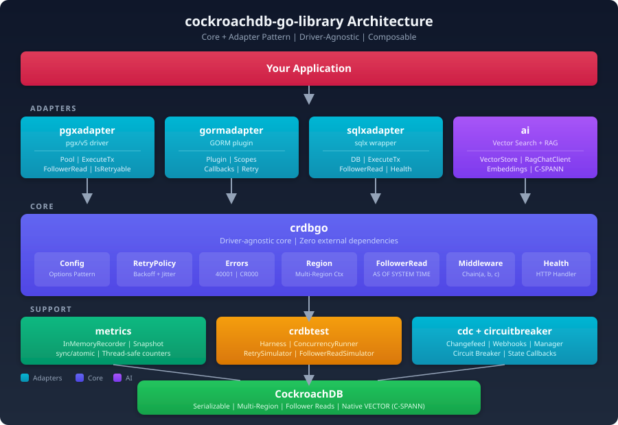

# cockroachdb-go-library

A Go library providing CockroachDB-specific features: automatic transaction retries, multi-region routing, follower reads, CDC, circuit breaker, AI/vector search, and composable middleware.

<!-- Badges (uncomment when CI is configured)
[](https://pkg.go.dev/github.com/cockroachlabs/cockroachdb-go-library)
[](https://github.com/cockroachlabs/cockroachdb-go-library/actions)
[](https://goreportcard.com/report/github.com/cockroachlabs/cockroachdb-go-library)
-->

## Overview

`cockroachdb-go-library` is an idiomatic Go library that wraps CockroachDB-specific behaviors into composable, driver-agnostic building blocks. It handles the hard parts of working with CockroachDB -- serialization conflict retries with exponential backoff, multi-region topology awareness, follower read queries, and health checks -- so your application code stays clean.

Core logic lives in the `crdbgo` package; driver-specific adapters (`pgxadapter`, `gormadapter`, `sqlxadapter`) bridge to your database layer. The `ai` package provides vector search, document storage, and RAG capabilities using CockroachDB's native VECTOR type. You only import the packages you need.

This is the Go sibling of the [Java Spring Boot Starter](https://github.com/cockroachlabs/cockroachdb-spring-boot-starter) and the [.NET Library](https://github.com/cockroachlabs/cockroachdb-dotnet-library).

## Architecture

<p align="center">
  
</p>

The library follows a **core + adapter** pattern:

| Layer | Package | Description |
|-------|---------|-------------|
| **Core** | `crdbgo` | Driver-agnostic types, retry logic, region management, follower reads, middleware, and health interfaces. Zero external dependencies. |
| **Adapters** | `pgxadapter`, `gormadapter`, `sqlxadapter` | Thin wrappers bridging core interfaces to pgx/v5, GORM, and sqlx. Each adapter depends only on `crdbgo` + its driver. |
| **Circuit Breaker** | `circuitbreaker` | Three-state circuit breaker (Closed/Open/HalfOpen) with middleware integration. |
| **CDC** | `cdc` | Changefeed SQL builder, webhook handler, manager, and metrics. |
| **Metrics** | `metrics` | In-memory and OpenTelemetry metrics recorders using `sync/atomic` for lock-free counters. |
| **Testing** | `crdbtest` | Test harnesses, concurrency runners, and retry/follower-read simulators. No live cluster required. |
| **AI** | `ai` | Vector search, document store, and RAG pipeline using CockroachDB native VECTOR type + C-SPANN index. |

## Installation

```bash
go get github.com/cockroachlabs/cockroachdb-go-library
```

Requires **Go 1.22+** (uses `math/rand/v2`).

## Quick Start

```go
package main

import (
	"context"
	"fmt"
	"log"
	"net/http"
	"time"

	"github.com/cockroachlabs/cockroachdb-go-library/crdbgo"
	"github.com/cockroachlabs/cockroachdb-go-library/crdbgo/metrics"
	"github.com/cockroachlabs/cockroachdb-go-library/crdbgo/pgxadapter"
)

func main() {
	ctx := context.Background()

	// 1. Create a metrics recorder
	recorder := metrics.NewInMemoryRecorder()

	// 2. Connect with CockroachDB-optimized config
	pool, err := pgxadapter.NewPool(ctx,
		"postgresql://root@localhost:26257/defaultdb?sslmode=disable",
		[]crdbgo.Option{
			crdbgo.WithMaxRetries(5),
			crdbgo.WithRegion("us-east-1"),
			crdbgo.WithIsolationLevel(crdbgo.Serializable),
		},
		pgxadapter.WithMetrics(recorder),
	)
	if err != nil {
		log.Fatal(err)
	}
	defer pool.Close()

	// 3. Execute a transaction with automatic retry on serialization conflicts
	err = pool.ExecuteTx(ctx, func(tx pgx.Tx) error {
		_, err := tx.Exec(ctx, "INSERT INTO accounts (id, balance) VALUES ($1, $2)", 1, 1000)
		return err
	})
	if err != nil {
		log.Fatal(err)
	}

	// 4. Follower read (reduced latency from nearest replica)
	rows, err := pool.QueryFollowerRead(ctx, "SELECT id, balance FROM accounts WHERE id = $1", 1)

	// 5. Health check endpoint
	http.Handle("/health", crdbgo.NewHealthHandler(pool))

	// 6. Check metrics
	snap := recorder.Snapshot()
	fmt.Printf("Transactions: %d (success: %d, retries: %d)\n",
		snap.TransactionCount, snap.TransactionSuccessCount, snap.RetryCount)
}
```

## Features

### 1. Automatic Transaction Retries

CockroachDB uses serializable isolation by default, which means transactions can fail with `SQLSTATE 40001` (serialization conflict) under contention. This library retries automatically with exponential backoff and jitter.

```go
// Default: 5 retries, 50ms initial delay, 5s max, 2x multiplier, jitter enabled
pool, _ := pgxadapter.NewPool(ctx, connStr, []crdbgo.Option{
	crdbgo.WithMaxRetries(10),
	crdbgo.WithInitialDelay(100 * time.Millisecond),
	crdbgo.WithMaxDelay(10 * time.Second),
	crdbgo.WithMultiplier(2.0),
	crdbgo.WithJitter(true),
})

// ExecuteTx handles the retry loop transparently
err := pool.ExecuteTx(ctx, func(tx pgx.Tx) error {
	// Your transaction logic here — will be retried on 40001
	_, err := tx.Exec(ctx, "UPDATE accounts SET balance = balance - $1 WHERE id = $2", 100, 1)
	return err
})
```

The retry policy is configurable per-pool and can be overridden per-transaction:

```go
// Override isolation level and read-only for a specific transaction
readOnly := true
isoLevel := crdbgo.ReadCommitted.String()
err := pool.ExecuteTxWithOptions(ctx, func(tx pgx.Tx) error {
	return tx.QueryRow(ctx, "SELECT balance FROM accounts WHERE id = $1", 1).Scan(&balance)
}, &pgxadapter.ExecuteTxOptions{
	ReadOnly:       &readOnly,
	IsolationLevel: &isoLevel,
})
```

**Error detection** works at two levels:
- **Core** (`crdbgo.IsRetryable`): driver-agnostic, uses `sqlStateError` interface to detect SQLSTATE codes
- **Adapter** (`pgxadapter.IsRetryable`): unwraps pgx's `*pgconn.PgError` struct field, then falls back to core

```go
// Use the adapter-level function for pgx errors
if pgxadapter.IsRetryable(err) {
	// SQLSTATE 40001 (serialization failure) or CR000 (CockroachDB retry)
}

// Use the core-level function for driver-agnostic code
if crdbgo.IsRetryable(err) {
	// Works with any error type implementing SQLState() string
}

// Check specific error types
if crdbgo.IsSerializationFailure(err) {
	// Only SQLSTATE 40001
}
```

### 2. Multi-Region Routing

Attach region metadata to `context.Context` for topology-aware connection routing. Resolve regions from static config, environment variables, or cloud metadata APIs.

```go
// Attach region context
rc := &crdbgo.RegionContext{
	Region:     "us-east-1",
	Gateway:    "gw-east",
	Localities: map[string]string{"zone": "us-east-1a"},
}
ctx = crdbgo.WithRegionContext(ctx, rc)

// Read it back anywhere downstream
if rc, ok := crdbgo.RegionFromContext(ctx); ok {
	fmt.Println("Routing to region:", rc.Region)
}
```

Build resolver chains with fallback behavior:

```go
resolver := &crdbgo.ChainRegionResolver{
	Resolvers: []crdbgo.RegionResolver{
		// Try cloud metadata API first (custom implementation)
		myCloudResolver,
		// Then environment variable
		myEnvResolver,
		// Final fallback
		&crdbgo.StaticRegionResolver{Region: "us-east-1"},
	},
}
region, err := resolver.Resolve(ctx) // Returns first successful resolution
```

### 3. Follower Reads

Reduce read latency by routing queries to the nearest replica using CockroachDB's `AS OF SYSTEM TIME` clause. Three modes are supported:

```go
// Mode 1: Let CockroachDB pick optimal staleness (recommended)
rows, err := pool.QueryFollowerRead(ctx, "SELECT * FROM products WHERE category = $1", "electronics")

// Mode 2: Specific staleness interval
clause := crdbgo.FollowerReadWithStaleness(10 * time.Second)
// "AS OF SYSTEM TIME '-10s'"

// Mode 3: Exact timestamp
clause := crdbgo.AsOfSystemTime(time.Now().Add(-30 * time.Second))
// "AS OF SYSTEM TIME '2024-06-15T12:29:30Z'"

// Single-row follower read
row := pool.QueryRowFollowerRead(ctx, "SELECT name FROM products WHERE id = $1", 42)
```

### 4. Metrics

Record transaction duration, retry counts, and follower read performance with the lock-free `InMemoryRecorder`.

```go
recorder := metrics.NewInMemoryRecorder()
pool, _ := pgxadapter.NewPool(ctx, connStr, opts, pgxadapter.WithMetrics(recorder))

// After running transactions...
snap := recorder.Snapshot()

fmt.Printf("Transactions:  %d total, %d success, %d failed\n",
	snap.TransactionCount, snap.TransactionSuccessCount, snap.TransactionFailureCount)
fmt.Printf("Retries:       %d (total delay: %v)\n",
	snap.RetryCount, snap.TotalRetryDelay)
fmt.Printf("Follower Reads: %d (total duration: %v)\n",
	snap.FollowerReadCount, snap.TotalFollowerReadDuration)
fmt.Printf("Avg Tx Duration: %v\n",
	snap.TotalTransactionDuration/time.Duration(snap.TransactionCount))

// Reset counters
recorder.Reset()
```

**Snapshot fields:**

| Field | Type | Description |
|-------|------|-------------|
| `TransactionCount` | `int64` | Total transactions executed |
| `TransactionSuccessCount` | `int64` | Successful transactions |
| `TransactionFailureCount` | `int64` | Failed transactions (non-retryable or exhausted retries) |
| `RetryCount` | `int64` | Total retry attempts across all transactions |
| `FollowerReadCount` | `int64` | Follower read queries executed |
| `TotalTransactionDuration` | `time.Duration` | Cumulative transaction time |
| `TotalRetryDelay` | `time.Duration` | Cumulative retry backoff time |
| `TotalFollowerReadDuration` | `time.Duration` | Cumulative follower read time |

Bring your own exporter by implementing the `MetricsRecorder` interface:

```go
type MetricsRecorder interface {
	RecordTransaction(duration time.Duration, retries int, success bool)
	RecordRetry(delay time.Duration)
	RecordFollowerRead(duration time.Duration)
}
```

### 5. Middleware Chain

Compose cross-cutting concerns (logging, metrics, tracing, region injection) into transaction execution pipelines using the middleware pattern.

```go
logging := func(next crdbgo.TxFunc) crdbgo.TxFunc {
	return func(ctx context.Context) error {
		slog.Info("tx start")
		err := next(ctx)
		slog.Info("tx end", "error", err)
		return err
	}
}

timing := func(next crdbgo.TxFunc) crdbgo.TxFunc {
	return func(ctx context.Context) error {
		start := time.Now()
		err := next(ctx)
		slog.Info("tx timing", "duration", time.Since(start))
		return err
	}
}

regionInjector := func(next crdbgo.TxFunc) crdbgo.TxFunc {
	return func(ctx context.Context) error {
		ctx = crdbgo.WithRegionContext(ctx, &crdbgo.RegionContext{Region: "us-east-1"})
		return next(ctx)
	}
}

// Chain executes left-to-right: logging wraps timing wraps regionInjector wraps handler
pipeline := crdbgo.Chain(logging, timing, regionInjector)
wrappedFn := pipeline(myTransactionFunc)
wrappedFn(ctx)
```

### 6. Health Checks

HTTP health endpoint compatible with any Go HTTP framework. Returns `200 {"status":"up"}` or `503 {"status":"down","error":"..."}`.

```go
// pgxadapter.Pool implements crdbgo.HealthChecker automatically
http.Handle("/health", crdbgo.NewHealthHandler(pool))

// Or implement your own
type customChecker struct{ db *sql.DB }
func (c *customChecker) Check(ctx context.Context) error {
	return c.db.PingContext(ctx)
}
http.Handle("/health", crdbgo.NewHealthHandler(&customChecker{db: myDB}))
```

### 7. Testing Utilities

Test CockroachDB-specific behavior without a live cluster using the `crdbtest` package.

**RetrySimulator** -- force serialization failures to test retry logic:

```go
func TestMyRetryLogic(t *testing.T) {
	sim := crdbtest.NewRetrySimulator(3) // fail 3 times, then succeed

	attempts := 0
	for {
		err := sim.Execute(func() error {
			return nil // your business logic
		})
		if err == nil {
			break
		}
		if !crdbgo.IsRetryable(err) {
			t.Fatal("unexpected non-retryable error:", err)
		}
		attempts++
	}
	// attempts == 3 (the simulator injected 3 retryable errors)
}
```

**ConcurrencyRunner** -- test under contention with barrier synchronization:

```go
func TestConcurrentTransfers(t *testing.T) {
	runner := crdbtest.NewConcurrencyRunner(10, 5) // 10 workers, 5 iterations each

	result := runner.Run(context.Background(), func(ctx context.Context, workerID int) error {
		// All 10 workers start simultaneously (barrier sync)
		// This maximizes contention for realistic testing
		return transferFunds(ctx, workerID)
	})

	t.Logf("Total: %d, Success: %d, Failures: %d, Duration: %v",
		result.TotalRuns, result.Successes, result.Failures, result.Duration)

	if result.Failures > 0 {
		t.Errorf("unexpected failures: %v", result.Errors)
	}
}
```

**FollowerReadSimulator** -- verify follower read SQL generation:

```go
func TestFollowerReadQuery(t *testing.T) {
	sim := crdbtest.NewFollowerReadSimulator()

	query := sim.SimulateRead("SELECT * FROM products")
	sim.AssertFollowerRead(t, query) // asserts AS OF SYSTEM TIME clause is present
}
```

**Test Harness** -- set up schemas and fixtures for integration tests:

```go
func TestWithHarness(t *testing.T) {
	h := crdbtest.NewHarness(t,
		crdbtest.WithConnectionString("postgresql://root@localhost:26257/testdb?sslmode=disable"),
		crdbtest.WithSchema(
			"CREATE TABLE IF NOT EXISTS accounts (id INT PRIMARY KEY, balance DECIMAL)",
			"INSERT INTO accounts VALUES (1, 1000) ON CONFLICT DO NOTHING",
		),
	)
	// Schema executed automatically, connection string available via h.ConnectionString()
}
```

### 8. AI / Vector Search / RAG

The `ai` package provides vector search, document storage, and RAG (Retrieval-Augmented Generation) using CockroachDB's native VECTOR type -- not pgvector. Three abstraction layers cover different use cases:

**Layer 1: VectorSearchTemplate** -- low-level SQL generation for full control:

```go
import "github.com/cockroachlabs/cockroachdb-go-library/crdbgo/ai"

db, _ := sql.Open("postgres", connStr)
template := ai.NewVectorSearchTemplate(db)

// Create table with VECTOR column
template.InitSchema(ctx, "documents", "embedding", 1536)

// Store an embedding
template.StoreEmbedding(ctx, ai.StoreOptions{
    Table:        "documents",
    IDColumn:     "id",
    VectorColumn: "embedding",
    ID:           "doc-1",
    Embedding:    myEmbedding, // []float32
    Metadata:     map[string]any{"content": "Hello world", "category": "greeting"},
})

// Search with cosine distance and C-SPANN beam size tuning
results, _ := template.Search(ctx, ai.SearchOptions{
    Table:        "documents",
    VectorColumn: "embedding",
    QueryVector:  queryEmbedding,
    Metric:       ai.Cosine,  // also: ai.L2, ai.InnerProduct
    Limit:        10,
    BeamSize:     8,           // tune C-SPANN accuracy (0 = CockroachDB default)
    Filter:       "category = 'greeting'",
})
```

**Layer 2: VectorStore** -- high-level document store with auto-embedding:

```go
// Bring your own embedder (implement ai.EmbeddingGenerator)
store := ai.NewVectorStore(db, myEmbedder,
    ai.WithTableName("knowledge_base"),
    ai.WithDistanceMetric(ai.Cosine),
    ai.WithBeamSize(8),
    ai.WithInitializeSchema(true),  // auto-create table on first use
)

// Add documents -- embeddings generated automatically
docs := []ai.VectorDocument{
    {Text: "CockroachDB is a distributed SQL database"},
    {Text: "Go is a statically typed language"},
}
store.AddDocuments(ctx, docs) // auto-generates UUIDs and embeddings

// Similarity search -- query is embedded automatically
results, _ := store.SimilaritySearch(ctx, "distributed databases",
    ai.WithTopK(5),
    ai.WithSimilarityThreshold(0.7),
    ai.WithFilterExpression("category = 'tech'"),
)
```

**Layer 3: RagChatClient** -- full RAG pipeline (retrieve context + LLM completion):

```go
// Bring your own LLM (implement ai.ChatCompletionProvider)
ragClient := ai.NewRagChatClient(store, myLLMProvider,
    ai.WithSystemPrompt("You are a CockroachDB expert."),
    ai.WithMaxContextDocs(5),
    ai.WithRagSimilarityThreshold(0.7),
)

// One-shot RAG
resp, _ := ragClient.Complete(ctx, "How does CockroachDB handle replication?",
    ai.WithTemperature(0.7),
    ai.WithMaxTokens(1024),
)
fmt.Println(resp.Content)          // LLM response grounded in retrieved docs
fmt.Println(resp.SourceDocuments)  // documents used as context

// Streaming RAG (tokens arrive via Go channel)
tokenCh, errCh := ragClient.Stream(ctx, "Explain consensus in CockroachDB")
for token := range tokenCh {
    fmt.Print(token) // stream to terminal/websocket
}
if err := <-errCh; err != nil {
    log.Fatal(err)
}
```

**Distance Metrics:**

| Metric | Operator | Best For |
|--------|----------|----------|
| `ai.Cosine` | `<=>` | Normalized embeddings (OpenAI, Cohere) |
| `ai.L2` | `<->` | Raw distance comparisons |
| `ai.InnerProduct` | `<#>` | Maximum inner product search |

### 9. DDL Helpers

Build CockroachDB-optimized DDL with inline indexes (~25x faster table creation):

```go
import "github.com/cockroachlabs/cockroachdb-go-library/crdbgo/ddl"

sql := ddl.CreateTableWithIndexes("orders", []ddl.ColumnDef{
    {Name: "id", Type: "UUID", PrimaryKey: true, Default: "gen_random_uuid()"},
    {Name: "customer", Type: "STRING(100)", NotNull: true},
    {Name: "total", Type: "INT8"},
}, []ddl.IndexDef{
    {Name: "idx_customer", Columns: []string{"customer"}},
    {Name: "idx_total", Columns: []string{"total"}, Storing: []string{"customer"}},
})
// Inline indexes = single schema-change job vs separate CREATE INDEX statements
```

Computed columns (STORED only — CockroachDB requirement):

```go
sql := ddl.ComputedColumnDDL("orders", ddl.ComputedColumnDef{
    Name:       "total_with_tax",
    Type:       "DECIMAL",
    Expression: "total * 1.1",
})
// → ALTER TABLE orders ADD COLUMN IF NOT EXISTS total_with_tax DECIMAL AS (total * 1.1) STORED
```

## Configuration Reference

### Config Options

| Option | Default | Description |
|--------|---------|-------------|
| `WithMaxRetries(n)` | `5` | Maximum retry attempts on serialization failures |
| `WithInitialDelay(d)` | `50ms` | Initial backoff delay |
| `WithMaxDelay(d)` | `5s` | Maximum backoff delay cap |
| `WithMultiplier(f)` | `2.0` | Backoff multiplier per retry |
| `WithJitter(b)` | `true` | Add randomized jitter to backoff ([50%, 100%] of delay) |
| `WithRegion(r)` | `""` | Default region for multi-region routing |
| `WithFollowerReads(d)` | `0` | Enable follower reads with specified staleness |
| `WithIsolationLevel(l)` | `Serializable` | Transaction isolation (`Serializable` or `ReadCommitted`) |
| `WithReadOnly(b)` | `false` | Mark transactions as read-only |

### Retry Policy Defaults

```
MaxRetries:   5
InitialDelay: 50ms
MaxDelay:     5s
Multiplier:   2.0
Jitter:       true

Delay progression (without jitter): 50ms → 100ms → 200ms → 400ms → 800ms
Delay progression (with jitter):    25-50ms → 50-100ms → 100-200ms → 200-400ms → 400-800ms
```

## Package Reference

| Package | Import Path | Purpose |
|---------|-------------|---------|
| `crdbgo` | `github.com/cockroachlabs/cockroachdb-go-library/crdbgo` | Core: config, retry, errors, regions, follower reads, middleware, health |
| `pgxadapter` | `github.com/cockroachlabs/cockroachdb-go-library/crdbgo/pgxadapter` | pgx/v5 adapter: pool, ExecuteTx, follower read queries |
| `gormadapter` | `github.com/cockroachlabs/cockroachdb-go-library/crdbgo/gormadapter` | GORM plugin with retry callbacks, scopes, and error classification |
| `sqlxadapter` | `github.com/cockroachlabs/cockroachdb-go-library/crdbgo/sqlxadapter` | sqlx wrapper with ExecuteTx, follower reads, health check |
| `circuitbreaker` | `github.com/cockroachlabs/cockroachdb-go-library/crdbgo/circuitbreaker` | Three-state circuit breaker with middleware integration |
| `cdc` | `github.com/cockroachlabs/cockroachdb-go-library/crdbgo/cdc` | CDC: changefeed SQL builder, webhook handler, manager |
| `metrics` | `github.com/cockroachlabs/cockroachdb-go-library/crdbgo/metrics` | In-memory and OpenTelemetry metrics recorders |
| `crdbtest` | `github.com/cockroachlabs/cockroachdb-go-library/crdbgo/crdbtest` | Testing: harness, concurrency runner, retry/follower simulators |
| `ai` | `github.com/cockroachlabs/cockroachdb-go-library/crdbgo/ai` | AI: vector search, document store, RAG pipeline (CockroachDB native VECTOR) |

## Sibling Projects

This library is part of a family of CockroachDB client libraries:

| Language | Project | Status |
|----------|---------|--------|
| **Go** | `cockroachdb-go-library` (this project) | Phase 4 complete (247 unit + 25 integration tests) |
| **Java** | [`cockroachdb-spring-boot-starter`](https://github.com/cockroachlabs/cockroachdb-spring-boot-starter) | v0.1.0-SNAPSHOT |
| **.NET** | [`cockroachdb-dotnet-library`](https://github.com/cockroachlabs/cockroachdb-dotnet-library) | Phase 2 (67 tests) |

## Roadmap

| Phase | Status | Features |
|-------|--------|----------|
| **Phase 1** | **Done** | Core library + pgx adapter + metrics + testing utilities (95 tests) |
| **Phase 2** | **Done** | GORM adapter + CDC + OpenTelemetry (170 tests) |
| **Phase 3** | **Done** | sqlx adapter + circuit breaker (208 tests) |
| **Phase 4** | **Done** | AI / Vector Search / RAG — CockroachDB native VECTOR + C-SPANN (247 tests) |
| **Phase 4.5** | **Done** | Integration tests (Testcontainers), demo app, Docker Compose, GoDoc |
| **Phase 5** | Planned | Connection load balancing, changefeed consumer, advanced follower reads |

## Running the Demo

The quickest way to see the library in action is via Docker Compose:

```bash
docker compose up --build
```

This starts a CockroachDB single-node cluster, seeds it with demo data, and launches the demo HTTP server on port 8080 with 9 routes:

| Method | Path | Description |
|--------|------|-------------|
| `GET` | `/health` | Health check |
| `GET` | `/metrics` | Metrics snapshot (JSON) |
| `POST` | `/tx/insert` | Insert account with automatic retry |
| `POST` | `/tx/transfer` | Transfer between accounts (serializable) |
| `GET` | `/follower-read` | Follower read query |
| `GET` | `/accounts` | List all accounts |
| `POST` | `/webhook/cdc` | CDC webhook endpoint |
| `GET` | `/circuit-breaker/status` | Circuit breaker state |
| `POST` | `/circuit-breaker/test` | Trip the circuit breaker |

```bash
# Insert an account
curl -X POST http://localhost:8080/tx/insert \
  -H 'Content-Type: application/json' \
  -d '{"name":"Diana","balance":500}'

# List accounts (follower read)
curl http://localhost:8080/follower-read

# Check metrics
curl http://localhost:8080/metrics
```

## Running Tests

```bash
# Unit tests (247 passing across 9 packages)
go test ./...

# With race detector
go test -race ./...

# Integration tests (requires Docker — uses Testcontainers)
go test -tags=integration ./...

# Both unit + integration
go test -tags=integration -race ./...

# Specific package
go test -v ./crdbgo/pgxadapter/...
go test -v ./crdbgo/ai/...
go test -tags=integration -v ./crdbgo/pgxadapter/...
```

Integration tests use [Testcontainers for Go](https://golang.testcontainers.org/) to spin up a real CockroachDB container. Docker must be running. Tests cover pgxadapter, sqlxadapter, gormadapter, ai (vector search), and circuitbreaker packages.

See [SETUP.md](SETUP.md) for detailed setup, testing, and demo instructions.

## Cockroach Continuum

Optional surfaces for [Cockroach Continuum](https://www.cockroachlabs.com/docs/continuum), separate from the core transaction path. Every client falls back to an in-memory simulated backend when no API key/endpoint is configured, so code compiles and runs without a Continuum organization.

```go
import (
    "github.com/cockroachlabs/cockroachdb-go-library/crdbgo/continuum/cloud"
    "github.com/cockroachlabs/cockroachdb-go-library/crdbgo/continuum/mcp"
    "github.com/cockroachlabs/cockroachdb-go-library/crdbgo/continuum/aegis"
)

// --- Cloud control plane (simulated until APIKey is set) ---
c := cloud.New(cloud.Config{Enabled: true, APIKey: key})
clusters, _ := c.ListClusters(ctx)

// Typed metric-export builders (datadog / cloudwatch / prometheus):
_ = c.ConfigureMetricExport(ctx, clusterID, cloud.DatadogExport(ddKey, "US1"))

// Readiness probe:
healthy := cloud.Health(ctx, c) == nil

// --- Virtual clusters + routing ---
vm := cloud.NewVClusterManager(db) // db is a pgx-style Execer
_ = vm.Create(ctx, "analytics")
dsn, _ := cloud.RoutingConnString(baseDSN, "analytics") // adds -ccluster option

// --- MCP client (real 2025-06-18 wire protocol) + Aegis over MCP ---
m := mcp.New(mcp.Config{Enabled: true, Endpoint: "https://cockroachlabs.cloud/mcp", Token: key})
tools, _ := m.ListTools()
ag := aegis.NewMCP(m, aegis.MCPToolNames{Findings: "list_findings"}) // discover names via ListTools
findings, _ := ag.Findings()
```

MCP is a public, versioned protocol, so the client speaks the real wire format (initialize handshake, `tools/list`, `tools/call`, SSE + session handling). The Aegis REST API is not yet public, so Aegis is reached read-only **over MCP** with caller-supplied tool names rather than an invented wire protocol.

Also in the `continuum` tree: a standalone **Aegis** client (findings/recommendations + app "exhaust"), **Plenum** storage insights, and **vCluster** workload tagging.

```go
// Aegis — simulated until an endpoint is set:
ag := aegis.New(aegis.Config{Enabled: true})
ag.Findings()
aegis.NewExhaust(ag).RecordRetry("PayrollService.runPayroll", attempt)

// Plenum — read-only, customer-safe storage insights:
tables, _ := plenum.Summary(ctx, pool)

// vCluster — workload tagging / QoS carried on the context:
ctx = vcluster.With(ctx, "analytics", vcluster.Low)
```

## Contributing

1. Fork the repository
2. Create a feature branch (`git checkout -b feature/my-feature`)
3. Write tests for new functionality
4. Ensure all tests pass: `go test -race ./...`
5. Submit a pull request

## License

Apache 2.0 -- see [LICENSE](LICENSE) for details.
